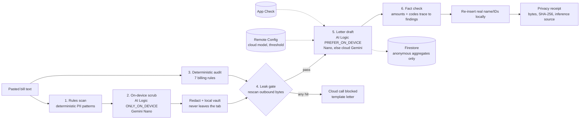

# BillShield: private medical bill audits with hybrid AI

[](https://github.com/dl88jing/billshield/actions/workflows/ci.yml)

**Find overcharges on a medical bill and get a dispute letter, without your name, DOB, MRN or insurance ID ever leaving your device.**

Built for [#BuildHybridAI 2026](https://firebasehybridaihackathon.devpost.com/), Web (Chrome) platform.
**Demo video (2:34):** https://youtu.be/5HYzI5j9pMw  
**Live:** https://billshield-kappa.vercel.app · **Measured results:** https://billshield-kappa.vercel.app/eval

## Why
A medical bill is the most identity-dense document most people own, and it is also often wrong (duplicate lines, unbundled lab panels, math errors, charges after discharge). Pasting it into a cloud chatbot means handing over your name, DOB, MRN, member ID and diagnosis. BillShield uses **hybrid inference as a privacy firewall**: the identity-bearing text is handled on-device, and the cloud model only ever sees redacted findings.

## How it works (end-to-end pipeline, not a chatbot)
1. **Rules scan** (deterministic): labeled names, DOB, MRN, member/account IDs, SSN, phone, email, address, Luhn-valid card numbers. Every later mention of a labeled name is caught too.
2. **On-device scrub**: Firebase AI Logic `getGenerativeModel(ai, { mode: InferenceMode.ONLY_ON_DEVICE })` (Gemini Nano via Chrome's Prompt API) proposes extra identifiers in free text (spouse names, spelled-out birthdays, oddly formatted phones). We use `ONLY_ON_DEVICE`, **not** `PREFER_ON_DEVICE`, because the latter may fall back to the cloud with raw PII. Responses whose `inferenceSource` is not `on_device` are rejected. Because `ONLY_ON_DEVICE` alone is not enough (in `@firebase/ai` 3.1.0, `getGenerativeModel` only creates the on-device adapter when `LanguageModel` exists, so on a browser without it even `ONLY_ON_DEVICE` requests go to the cloud), the raw-text request is never built unless Chrome reports the model as `available`; `tests/raw-text-guard.test.ts` checks that no network call is made otherwise. Model proposals are only applied if the exact string exists in the bill, so hallucinated edits are impossible.
3. **Deterministic audit**: 7 rules (`src/lib/audit.ts`): DUPLICATE, MATH (qty × unit), TOTAL (subtotal reconciliation), UNBUNDLE (NCCI-style panel components), DOUBLE_EM, POST_DISCHARGE, PRICE_OUTLIER (advisory). The model never decides what is wrong with the bill.
4. **Leak gate** (deterministic): the outbound payload is re-scanned with every pattern plus every original identifier. A single hit **blocks the cloud call**.
5. **Dispute letter**: Firebase AI Logic `InferenceMode.PREFER_ON_DEVICE` drafts the letter from the redacted findings (Gemini Nano if the browser has it, cloud Gemini otherwise), using placeholders like `[NAME_1]` and `[ACCOUNT_1]`. Real values are re-inserted **locally** from an in-memory vault that never leaves the tab.
   **English, Spanish or Japanese letters**: pick *Español* or *日本語*. The findings themselves are localized **on-device and deterministically** before anything is sent (`src/lib/i18n.ts`): each finding carries structured `facts` (quantities, unit prices, dates, codes), and the Spanish/Japanese finding sentences, service names and spelled-out dates are built from those facts, so the model never has to translate English finding text and cannot quote it back in English. Billing codes and `$` amounts stay byte-for-byte identical across languages, so the same fact checker and leak gate apply; the fact checker also normalizes full-width characters (`＄１２３` → `$123`) and rejects money written any other way (`1,234.56ドル`, `1.234,56 $`, `120 dólares`), which would otherwise dodge the amount check. The name is re-inserted on-device exactly as in English. If the model letter is rejected, or you're offline, a deterministic Spanish or Japanese template is used. `tests/letter-es.test.ts` and `tests/letter-i18n.test.ts` cover this on all 45 sample bills.
6. **Privacy receipt**: shows the exact outbound payload, its byte count and SHA-256, and which inference source handled each step.
7. **Installable, works offline (rules-only)**: BillShield is a PWA (`src/app/manifest.ts`, `public/sw.js`). The service worker caches the app shell, so after one visit the rules scan, on-device scrub, leak gate, bill audit and a deterministic template letter all run with the network off. **Cloud letter writing needs a connection**: offline, the app skips the cloud call (and the Firestore stats write) and says so. The service worker never intercepts or caches cross-origin requests (Firebase AI Logic, Firestore, App Check, reCAPTCHA); `tests/pwa.test.ts` checks that, and `scripts/e2e/offline.mjs` reloads the site in headless Chrome with the network off and runs Sample 1.

## Architecture

Trust boundary: everything left of the leak gate runs in the browser tab; only the redacted findings payload can reach the cloud model.

## Try it in 30 seconds
Open https://billshield-kappa.vercel.app in desktop Chrome, click **Sample 1**, then **Audit privately**. Or locally: `npm ci && npm run dev`.

## Measured results: see [/eval](https://billshield-kappa.vercel.app/eval)
**Rules layer** (40 seeded synthetic bills, no model):
| Metric | Result |
|---|---|
| Billing-error rules, precision / recall | 100% / 100% on planted errors (7 rules) |
| Clean bills falsely flagged | 0 / 11 |
| Labeled PII leaked | 0 / 440 |
| **Free-text PII leaked, rules-only** | **67 / 68 (miss)** |

**Cloud letter path** (live site, headless Chrome without Gemini Nano, so `PREFER_ON_DEVICE` falls back to cloud `gemini-3.5-flash-lite` via Firebase AI Logic), 12 bills:
| Run | Cloud letters accepted | Rejected by fact checker | Call failures | What we learned |
|---|---|---|---|---|
| v1 | 4 | 4 | 4 | model invented placeholders (`[DATE_1]`, `[ADDRESS_2]`); 401 App Check errors |
| v2 | 4 | 2 | 6 | prompt fixed (0 invented placeholders); the 2 rejections were a **checker bug** (whole-dollar `$15`), now fixed |
| v3 | **12** | 0 | 0 | 12/12 fact-check pass, 12/12 redaction-guard pass (some calls needed one retry) |

The free-text miss is published on purpose: it is exactly what the on-device Gemini Nano pass exists to fix. Model-on (Nano) numbers are not measured yet; they need desktop Chrome with Gemini Nano.
Reproduce: `npm run eval` and `npm test` (37 tests, also run in CI with lint and typecheck). Cloud eval: `scripts/e2e/cloud_eval.mjs` (Playwright against the live site).

## Firebase usage (project `billshield-d2dcb`, Spark plan)
- **Firebase AI Logic** (`firebase/ai`, Gemini Developer API backend):
  - Raw bill text → `getGenerativeModel(ai, { mode: InferenceMode.ONLY_ON_DEVICE })`. We deliberately do *not* use `PREFER_ON_DEVICE` here, because it may fall back to the cloud with raw PII. Any response whose `inferenceSource` isn't `on_device` is rejected.
  - Redacted findings → `InferenceMode.PREFER_ON_DEVICE` with `inCloudParams.model` from Remote Config: Gemini Nano when present, cloud Gemini otherwise. `response.inferenceSource` is shown in the privacy receipt.
  - `initializeDeviceModel()` is called on the user's click (Chrome user-activation rule).
  - Model default: `gemini-3.5-flash-lite` rather than `gemini-2.5-flash-lite`, because the Firebase docs say 2.5 Flash requests get rerouted from Dec 1, 2026, before judging.
- **App Check** (`firebase/app-check`): `ReCaptchaEnterpriseProvider` by default (`NEXT_PUBLIC_APPCHECK_PROVIDER=enterprise`), because Google deprecated reCAPTCHA v3 onboarding. `ReCaptchaV3Provider` remains available if the provider is set to `v3`. A token probe runs at startup. If it fails, the AI call is still attempted (retried once without the App Check header) and the failure is shown in the privacy receipt.
- **Remote Config**: `cloud_model` and `outlier_multiple` (audit threshold), with in-code defaults.
- **Firestore**: writes only anonymous aggregate stats (rule counts, a dollar bucket, inference sources, gate result) to `aggregate_runs`. No bill text, no identifiers. Locked-down rules are in `firestore.rules`; a contract test (`tests/firestore-contract.test.ts`) checks that the record the app writes matches the rules' field allow-list and contains no identifiers or exact dollar amounts.

## Honest status (Nov 16, 2026)
- ✅ Firebase AI Logic is live. The cloud letter path works end to end on https://billshield-kappa.vercel.app (verified in headless Chrome; the receipt shows "Firebase AI Logic · cloud (Gemini)", and the redaction guard passes).
- ✅ **App Check is registered with the reCAPTCHA Enterprise provider.** Verified Nov 16, 2026 on https://billshield-kappa.vercel.app in headless Chrome: the pill reads `App Check (reCAPTCHA Enterprise): token OK`, the privacy receipt reads `token OK (reCAPTCHA Enterprise)`, `exchangeRecaptchaEnterpriseToken` returns 200, and the cloud letter request includes the `X-Firebase-AppCheck` header. The leak gate still reported `0 identifiers in 540 outbound bytes` on Sample 1. **Enforcement is still off.** We use Enterprise because Google deprecated reCAPTCHA v3 onboarding. If a token cannot be minted, the app still retries once without the header and otherwise falls back to the deterministic template letter.
- ✅ **Firestore aggregate writes work.** Re-verified Nov 15, 2026 on the live site in headless Chrome: the privacy receipt shows "Anonymous stats (Firestore): rule counts + $ bucket saved", and the Firestore Write channel returns 200. Unauthenticated reads of `aggregate_runs` (and any other collection) return `403 PERMISSION_DENIED`, which matches the client read lock in `firestore.rules`. (Earlier on Nov 14, writes failed with `Missing or insufficient permissions`; that is now resolved.)
- ⚠️ On-device inference requires desktop Chrome 139+ with Gemini Nano. The demo video and evals were recorded in headless Chrome with **no** Nano, so the on-device step shows "skipped / rules-only". That is labeled in the video and the UI.
- ✅ **Installable PWA, offline rules-only mode** (Nov 16): headless Chrome confirms the manifest (standalone, 192/512 and maskable icons) and the service worker control the page; with the network switched off, a reload still loads and Sample 1 still yields $380.23 at stake, a passing leak gate, and a template letter with the name re-inserted locally. Offline, there is no cloud letter.
- ✅ **Spanish dispute letters** (Nov 16): the prompt, template, fact check and on-device name re-insertion are unit-tested. The live cloud check is in `scripts/e2e/letters.mjs --lang=es`.
- ✅ **Japanese letters + localized findings** (Nov 17): Spanish and Japanese payloads and letters no longer contain English finding text; checked live with `scripts/e2e/letters.mjs --lang=ja` / `--lang=es`.
- Sample bills are synthetic. Reference prices are illustrative, not a fee schedule. Not legal or medical advice.

## Run locally
```bash
npm ci
cp .env.example .env.local   # Firebase web config (public client config); .env.local is gitignored
npm run dev                  # http://localhost:3000 in desktop Chrome
npm test && npm run lint && npx tsc --noEmit && npm run eval
```

## What was built during the submission period
Everything in this repo was created from scratch on Nov 14, 2026 (submission period Nov 11 – Nov 30). Standard tooling only: Next.js 15, Tailwind, Firebase JS SDK v13; code written with AI coding assistants.

## License
Apache-2.0 (see `LICENSE`).
